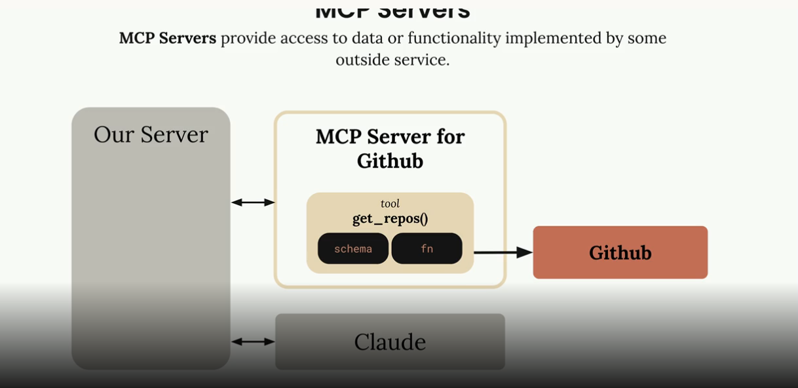
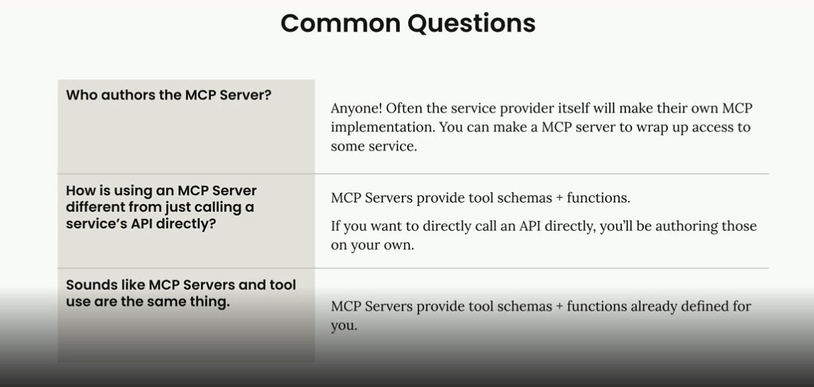
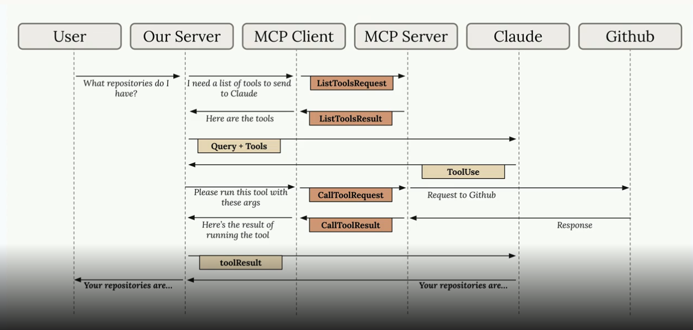
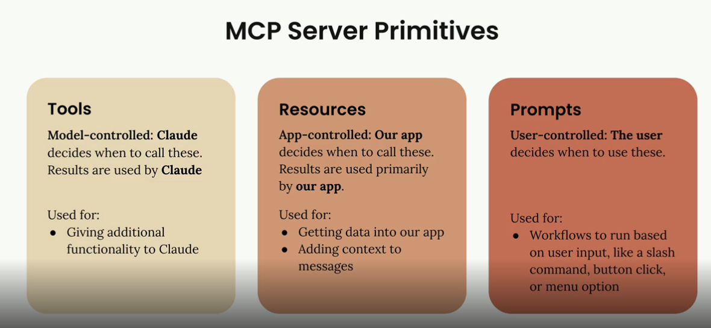

[Claude MCP Course](https://anthropic.skilljar.com/introduction-to-model-context-protocol)

## Claude MCP

### What is MCP?

- AI models are powerful, but they’re isolated. They can answer questions, generate code, and analyze text, but they can’t fetch live data, access your APIs, or interact with external systems. Every time you need an AI to do something in the real world, you’re stuck bridging the gap yourself.

MCP (Model Context Protocol) solves this. It’s an open standard that gives AI models a universal way to discover, understand, and use external tools and data sources. Think of it as USB for AI: a single protocol that lets any AI model plug into any tool you build.

- Earlier for example if we have to list all the repos from github on to a Web UI , user has to call an API , write the logic using github sdk , do the reporting. But MCP will do this bull work for us inside its server for us when we give a prompt.
- MCP exposes the functionality of an outside service to you.

- 

- `MCP common question`
  

- MCP client and MCP server communication is Transport agnostic. It can be HTTP, WebSocket, or any other transport protocol. The client sends a request to the server, and the server responds with the requested data or action. When on same machine they can communicate in Stndard Input/Output (stdin/stdout) mode. The client sends a request to the server's standard input, and the server responds with the requested data or action on its standard output.
  

- 

- [Typescript SDK](https://platform.claude.com/docs/en/cli-sdks-libraries/sdks/typescript) for MCP client and server communication. The SDK provides a set of tools and libraries that make it easier to build and deploy MCP clients and servers. It includes features such as request/response handling, error handling, and logging.

- MCP Servers can contain tools, resources(@) and prompts(/)
- 
- resources can fetch little bit of mcp-server data , without the usage of tools
- we have 3 types of resources in MCP server
  - `Resource` - A resource is a piece of data that can be fetched from the server. It can be a file, a database record, or any other type of data that the server can provide. Resources are typically used to provide context to the AI model, such as user information, configuration settings, or other relevant data.\
    - Templated Resource - A templated resource is a resource that contains placeholders for dynamic values. The placeholders can be filled in with specific values at runtime, allowing the resource to be customized for different situations. Templated resources are typically used to provide context to the AI model that is specific to the current request or user.
  - `Tool` - A tool is a function or action that can be performed by the server. It can be an API call, a database query, or any other type of operation that the server can perform. Tools are typically used to perform actions on behalf of the AI model, such as fetching data from an external service, performing calculations, or executing commands.
  - `Prompt` - A prompt is a message or instruction that is sent to the AI model. It can be a question, a command, or any other type of instruction that the model can understand. Prompts are typically used to guide the AI model's behavior and to elicit specific responses.

Note: check mcp-review lesson last one for more details on MCP server primitives.

- `You will have MCP SDK based on the programming language you are using. For example, if you are using Python, you will have a Python SDK for MCP. If you are using JavaScript, you will have a JavaScript SDK for MCP. The SDK will provide you with the necessary tools and libraries to build and deploy MCP clients and servers in your chosen programming language.`
- These SDKs will help you to build and deploy custom MCP clients and servers in your chosen programming language. The SDKs will provide you with the necessary tools and libraries to handle request/response handling, error handling, and logging. You can use the SDKs to create custom MCP clients and servers that can communicate with each other over different transport protocols.

## Advanced Topics in MCP

- `Sampling` , MCP server sends request to MCP Client to generate the response for the request sent by MCP server. MCP client connects to Claude or any LLM to generate the response , MCP client can generate multiple responses for the same request and send it back to MCP server. MCP server can then sample from these responses to select the best one to send back to the AI model.

- `Logging and Notifications` : This enable the user to see the response generated by the MCP client and also to get notified when the response is generated. This can be useful for debugging and monitoring the performance of the MCP client and server.

- `Root`: You can give the claude permissions to access particular folders/dorectory ahead of time, 
         - When that information is given to claude we can directly refer to the file in that folder instead of giving the full path 
         - When fullpath is given , and the permissions are not given to claude , the claude will reject operations on that file

## Transports and Communication
 - 