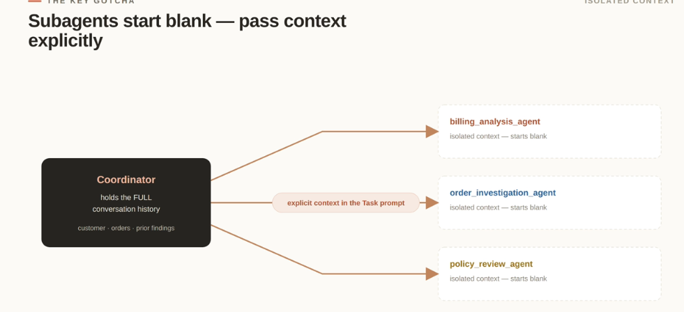
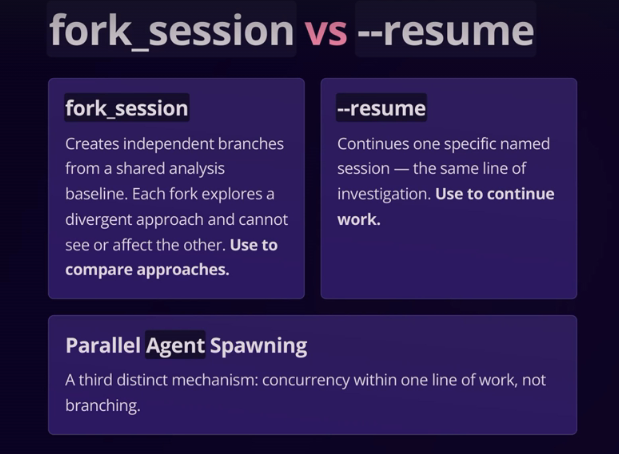
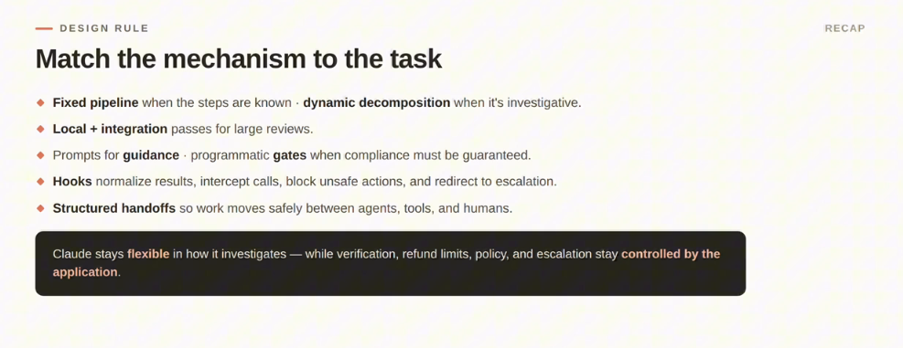
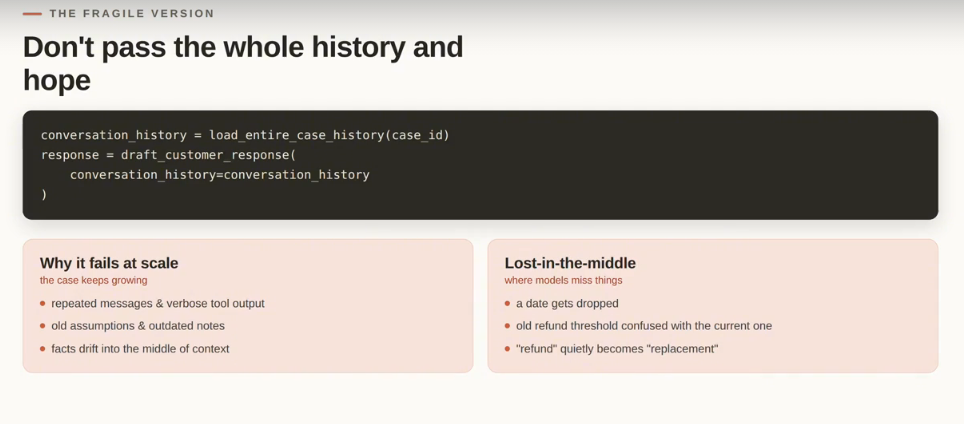
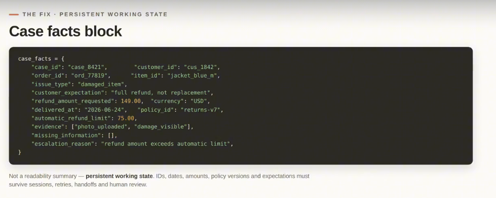
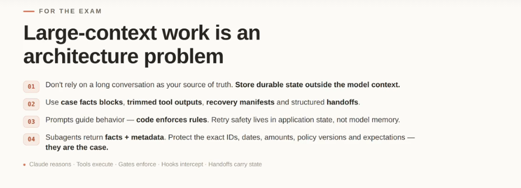

## Agentic architecture and Orcestration

### Coordinators Subagents and Context-Passing

- Instead of on single agent solving a complex problem , a `coordinator agent` recieves a task and breaks it down into smaller sub-tasks, which are then assigned to `subagents`.
- Each subagent is responsible for solving its specific sub-task.
- The coordinator agent collects the results from the subagents and combines them to produce the final output.
- This approach allows for parallel processing and can lead to more efficient problem-solving.
- This is called as `HUB and SPOKE` architecture, where the coordinator acts as the `hub` and the subagents act as the `spokes`.
- `Example:` In below example there are multiple questions , in such scenario `hub and spoke` architecture can be used to solve the problem efficiently.
  <i>
  Hi I have been charged twice for my order A1042.
  Also I have recieved dammaged headphones. Can you please help me with this?
  May I know if I can recieve the refund for my previous order charger,which is not what I have expected
  </i>
- 

- `Task Tool` spawns different sub agents

- **Sub-agents don not automatically inherit the context of the coordinator agent. Subagents have isolated context** The coordinator must explicitly pass relevant context to each subagent to ensure they have the necessary information to perform their tasks effectively. They function in stateless manner.

### Multi Agent Orchestration

- `Cordinator Responsibilites`
  - Observability: Every message is logged and can be monitored at one place.
  - Consistent Error Handling: One uniform Recovery policy is applied centrally.
  - Controlled Information Flow: The coordinator decides what context each subagent receives, ensuring that sensitive information is not inadvertently shared.
- `NOTE`: Direct subagent-subagent communication destroys all the above 3 , its an anti-pattern
- Cordinators duties also include:
  - `Task Decomposition`: Breaking down complex tasks into smaller, manageable sub-tasks.
  - `Dynamic Subagent Management`: Assigning tasks to appropriate subagents based on their capabilities and availability, dynamically.
  - `Research Scope Partitioning`: Dividing the research scope into smaller, focused areas that can be handled by different subagents and distributing it to subagents avoiding duplication.
  - `Iterative Refinement loops`: Evaluate aggregated results for gaps and re-delegate targeted followups , Orchestration is not one shot

- `Isolation is per-invocation`
  - Every invocation is independent, which means there is no store where subagents can lookup
  - Coordinator must pass facts explicity

- `fork-session Vs --resume`
- 

- `Hooks`
- `pre_tool_use` : this tools runs before the tool execution, generally used for pre-processing, validation etc blocks unsafe calls, redirect to escalation etc
- `post_tool_use` : generally used for scenarios of data-mapping, formatting etc, this hooks runs after the tool execution

- `handOff`: handoff carries facts , not just `please review`
- `SubagentStart`: fires when subagent is spawned by Agent
- `SubagentStop`: fires when subagent finishes
- ScopedHooks: subagent can have its own pre/post tool hooks, which are scoped to that subagent only.
- 

### Design rule

### Conversation History is not Database
- 
- A fix for converssation history is `case fact blocks`
 - 

### Large Context is not a Prompt Problem, its Architecture Problem
- 