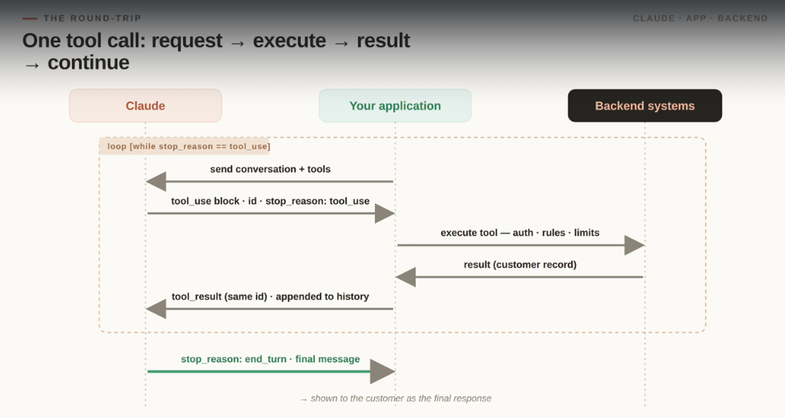
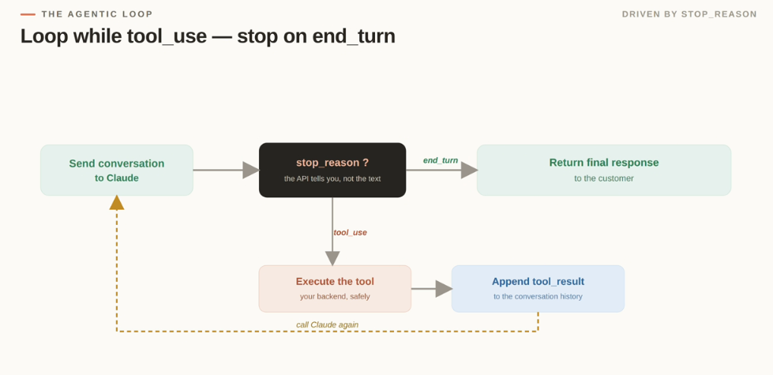
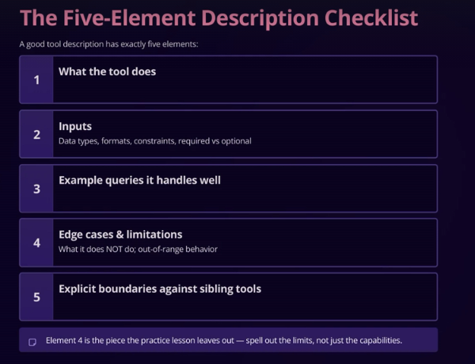
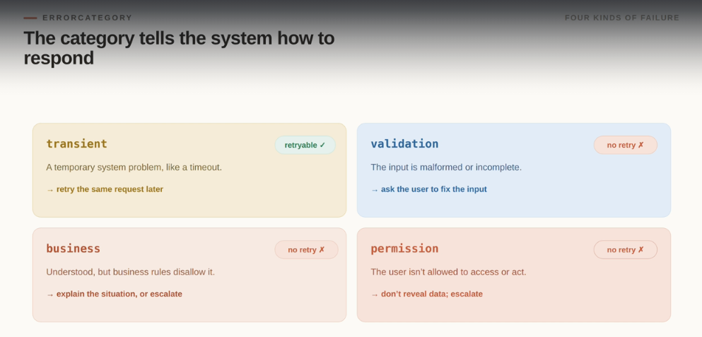
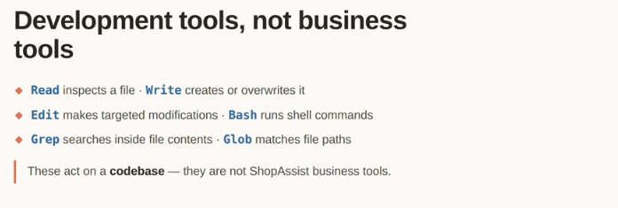
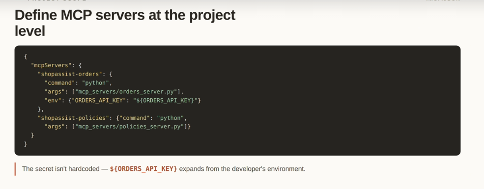
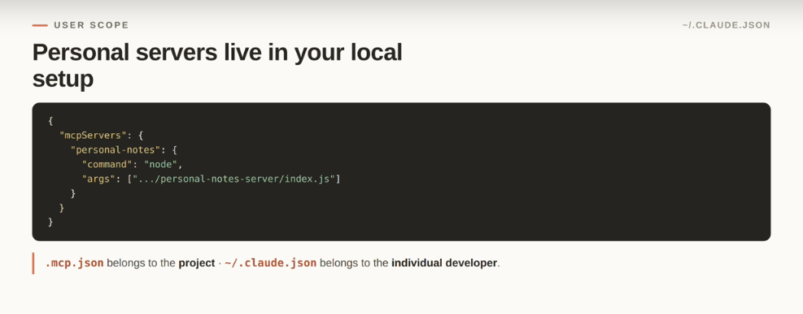
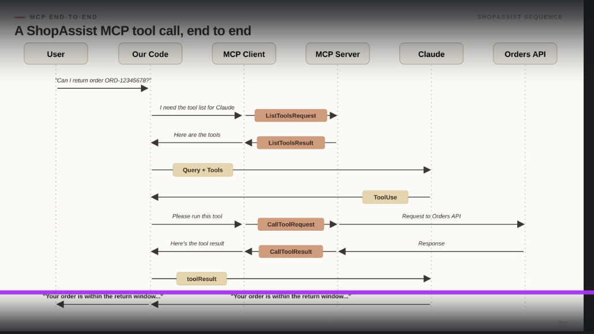

## DOMAIN 2: Tool Design and MCP Integration (18% in Exam)

- How Claude connects to outside world , is through the use of tools.
- Tools are external applications or services that Claude can interact with to perform specific tasks or retrieve information.
- These tools can be integrated into Claude's architecture to enhance its capabilities and provide users with a more comprehensive experience.

- Claude doesn't execute tools, it only decides which tool to use
- Your application executes the tool and returns the result to Claude.

- `tool_use block`: contains 3 pieces of information
  - `tool_name`: The name of the tool that Claude has selected to use.
  - `tool_input`: The input or parameters that Claude provides to the selected tool for execution.
  - `tool_id`: A unique identifier for the tool execution instance, which can be used to track and manage the execution process.

- when claude requests for tool_use, the `stop_reason` is set to `tool_use` and the tool_use block is included in the response. The tool_use ends when `stop_reason = end_turn`

- Make sure the response of tool_use is to be added to Message history ,

- Tool Execution Flow:
- 

- Tool Execution Loop:
  - 

### Example of tool use

- `ai-from-roadmap/claude-certification/claude-api-demos/claude-tools.js`

### How does Claude pick a right tool?

- Give meaningful `tool_names`, `description` ex: get_customer_by_email, lookup_order_by_id.
- description can include purpose, examples and specific requirement
- 

- Error Category:
  - 

### Built In tools from Claude

These are code tools that are already built into Claude and can be used without any additional setup or configuration. These tools are designed to perform common tasks and operations that are frequently needed in various applications.

- Read + Write : Reads content of files, write content to files
- Edit: Edits the file contents
- Grep: searches the text
- Glob: matches the path
- Bash: runs shell scripts
- 

### MCP Tools
`MCP in short = tools built on server and exposing them to claude via mcp.json configuration file.`, Earllier you were building tools with anthropic sdk and exposing them. check claude-tools.js

MCP is to give claude controlled backend capabilites through clear , typed , well described interfaces.

MCP w.r.t claude is a set of tools that are designed to perform specific tasks or actions within the context of a particular application or system. These tools are typically integrated into the application or system and can be used to automate processes, perform calculations, or manipulate data.

- `MCP Tools` : they do action they do work
- `MCP Resources`: they provide context, content for tools to do actions like refund_policy.md, product_catalog.md etc

- `mcp.json` , there are two types of mcp.json files 
    -  `Project level mcp.json`: communinity mcp servers publicly available mcp servers like figma, github, slack etc
    -  `local level mcp.json`: your custom/local/developers  mcp servers  they can be configured inside users/claude.json
   - this is a project file where we create configuration of mcp_server
   - 
   - 
   - the server exposes capabilities/permissions of the mcp server, which are used by agents to decide which mcp-server to use.

- 

### Summary:
-  don't overload the agent with tools ideally 4-5 tools are enough, if you have more than 5 tools, then create a new agent and assign the tools to that agent.
-  if tool_choice={"type":"any"}, gurantees structured output when input is unknown
- When using `Edit Tool`, if you don't find the match of string don't quickly jump to read+write , search for cheaper options like , expand the "old_string" by giving more context , use replace_all when you want to change all the instances, if nothing works fall back to `Read + Write` tool.

