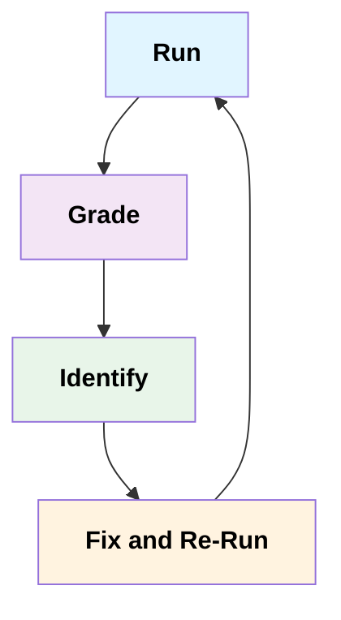
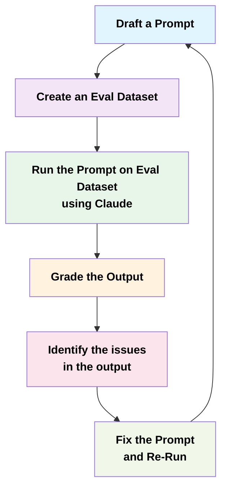
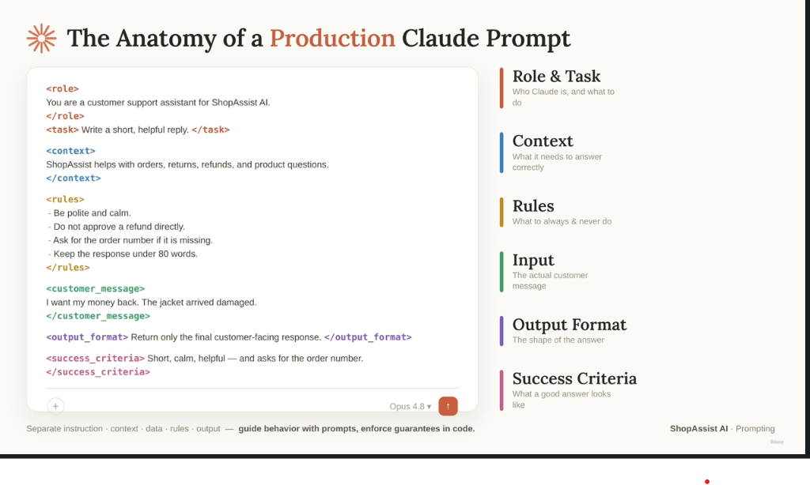
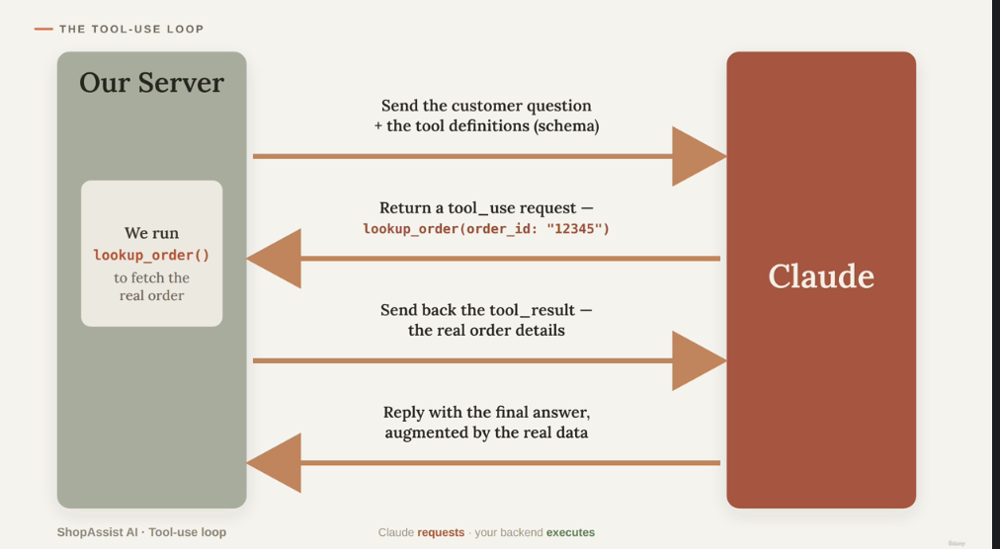
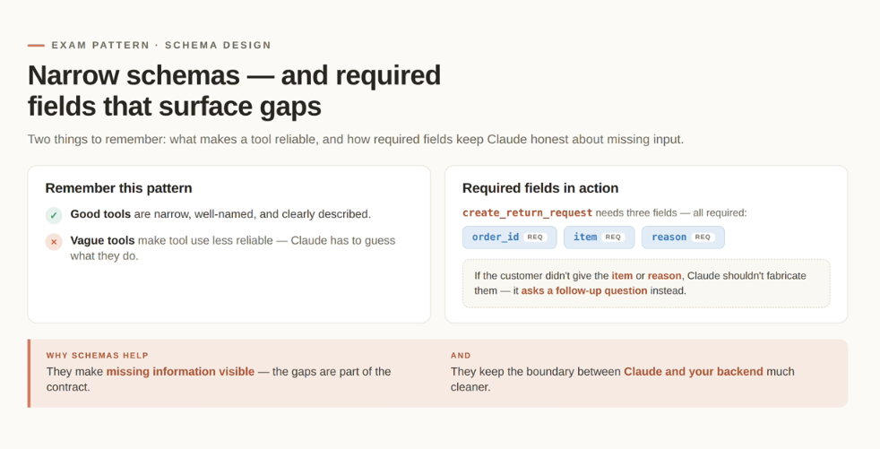
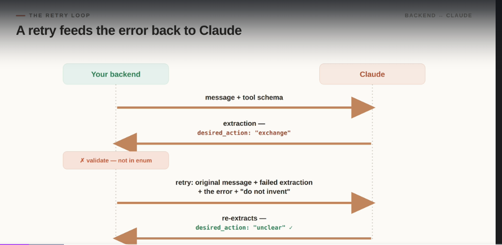
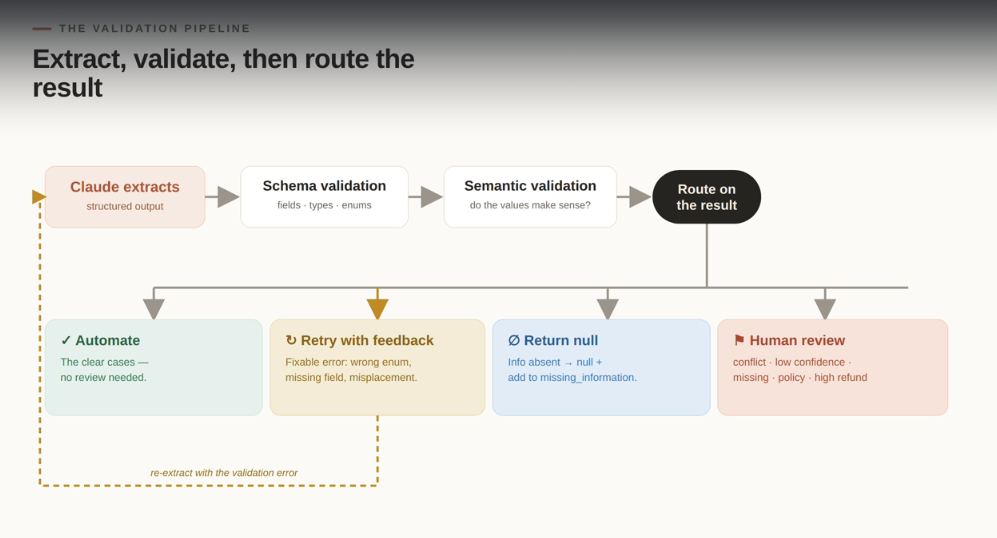
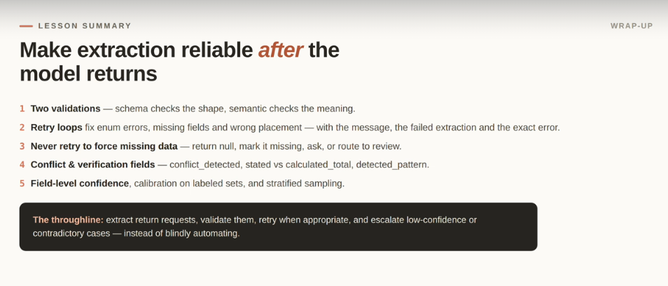
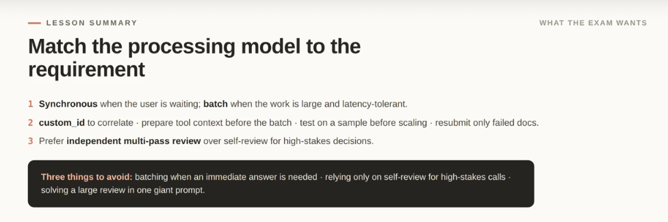
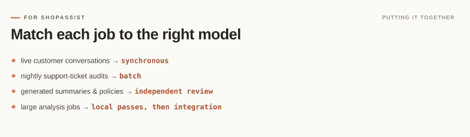

## Prompt Engineering and Evaluation Part 1

- Run --> Grade --> Identify --> Fix and Re-Run --> cyclic loop this is called as Eval loop

- Draft a Prompt --> Create an Eval Dataset --> Run the Prompt on Eval Dataset using Claude --> Grade the Output --> Identify the issues in the output --> Fix the Prompt and Re-Run

### Grading Output

- There are 3 ways of Grading the output
  - Code Based Grading: `structure` can be used for well structred out put ex: JSON
  - Model Grading: `judgement` quality, policy, politeness, tone, behaviour, is ordernumber there etc etc - Can create a prompt to grade the output , ask to score on rate of 1-10,
    passed, reason for failure
  - Human Based Grading

- We can use both types of grading and combine and get a result

Good Prompt should include

- Role: Who claude should be
- Task : What should it do
- Rules: What to Follow
- Format: What Should it return

- You can use <xml> tags to separate the section of prompts
- <json> tags can be used to define structured output

- 

- When you are presented a question on prompt , vague prompt
  - check each and every word is quantified or explained properly
  - check if examples are given with for different categories of questions,
    with different severity levels (calibrate severity), with different edge cases show claude with examples
    don't write prose.
  - keep output format consistent and structured
  - use backend validations for critical requirements

## Structured Output and Extraction

- Claude should NOT invent answers , rather it should mack use of backend `tools` for formulating answers
- 
- tool examples at `ai-from-roadmap/claude-certification/claude-api-demos/claude-tools.js`
- 
- Three ways to control if claude should use tools or not
  - `auto` Claude decides to use a tool or not based on the prompt and context, and serves the response from the info available {type:'auto'}
  - `any ` Claude has to use a tool, but the tool choice is with claude, it can choose any tool to use {type:'any'}
  - `forced tool` restrict claude to use a specific tool everytime {type:'tool', name:"tool_name"}
  - "return valid json", this might not work for all cases , tool_use + input_schema will definetly work
    - if claude is not able to find the answer from the tools, it will return a valid json with empty values, but it will not invent answers.
    - if claude is able to find the answer from the tools, it will return a valid json with values filled in.

  - Structured Output(tool_use + schema) just produces a valid JSON, it doesn't gurantee that it produces the correct output, hence its importantat to validate the output that is produced in production environments.
  - There are two types of Validation that can be done to ensure the output is correct and valid
    - `Schema Validation`: validate if all the necessary fields are present in the output and if the data types are correct, if not return a valid json with empty values. Don,t add new values.
    - Semantic Validation: Though the schema is correct, the values might not be correct, hence we need to validate the values semantically. For example, if claude is asked to return a valid order number, it should check if the order number is present in the backend database or not. If not return a valid json with empty values. Don't add new values. Or categorising the issue incorretly for missing_order saying it as refund_request , that is a meaning problem not schema problem.
      - If semantic validation fails , backend should check it and see if it can send for retry, with correct feedback to claude.
    - 

- `Validation Pipeline`
  - 
  - If the output is not valid, it should be sent for retry with correct feedback to claude, so that claude can learn from its mistakes and produce a valid output next time.
  - 

  - `Unfixable Category`: In these cases solution is to ask Claude to send null and followed by Human-Review, a retry in such cases will force claude to fabricate an answer and hence it is better to send it for Human-Review. For example, if claude is asked to return a valid order number, but the order number is not present in the backend database, it should return a valid json with empty values and send it for Human-Review. Don't add new values.
  - 
  - Log every detected_pattern case , this will help in improving the prompt and the model, and also help in identifying new patterns that can be added to the prompt for better performance.

- `Batch Processing and Multi-Pass review`
- What if the requests are in 1000s or 10000s, what if the documentation is not one document but 1000s , in that case we can use batch processing , batch processing can be used for requests which doesn't require immediate response. Batch Processing operates `asynchronously` , the response is not immediate
  Ex: Audit Support tickets from last night , this may need batch processing
- Batch processing can take upto 24hrs , there is no SLA for batch processing,
  require immediate response. Batch Processing operates `asynchronously` , the response is not immediate
  The immediate advantage we get with batch processing is , `50% cost reduction` when compared to synchronous call.
  Lets say a customer is chatting, batch processing cannot be used in this case .
- Batch processing should have stable ids, because response of batch processing is not linear, stable_ids also used to track the failures and if stable_id is there we can retry that specific failure case again.

- `Multi-Pass Review`: In this case, the output of the first pass is sent for `local review` (review by claude itself , it will try to justify its reasoning), who can provide feedback and corrections. The corrected output is then sent back to Claude for a second pass, where it can learn from the feedback and check rules such as conflict, assumptions, repeated issues etc and produce a more accurate output. This process can be repeated multiple times until the desired level of accuracy is achieved.
- Rather that having one gaint prompt, split the prompts into multiple prompts thus making multi-pass review possible, this will help in reducing the complexity of the prompt and also help in identifying the issues in the output more easily.
- local review should come from a different/fresh session, but not within the same session, because claude will have a bias towards its own output and it will not be able to identify the issues in its own output. Hence it is important to have a fresh session for local review.

- 

- 

- When you get unstructed request, you need to extract the structred information ,
- For that you need a tool which can do that 
- in this case tool_choice={type:'tool', name:'tool_name'} , is required , we can just ask to return json schema
- once the response is recieved in the desired structured format, the response is syntactically validated correct but it can go wrong semantaically hence .
- send the response to `validation pipeline` for semantic validation, if it fails send it for retry with correct feedback to claude send only that can be re-tryed, if it fails again 
- send it for `Human-Review` with correct feedback to claude. ensure claude should not invent missing information. Human review when conflict, policy exception, refund etc etc
- 