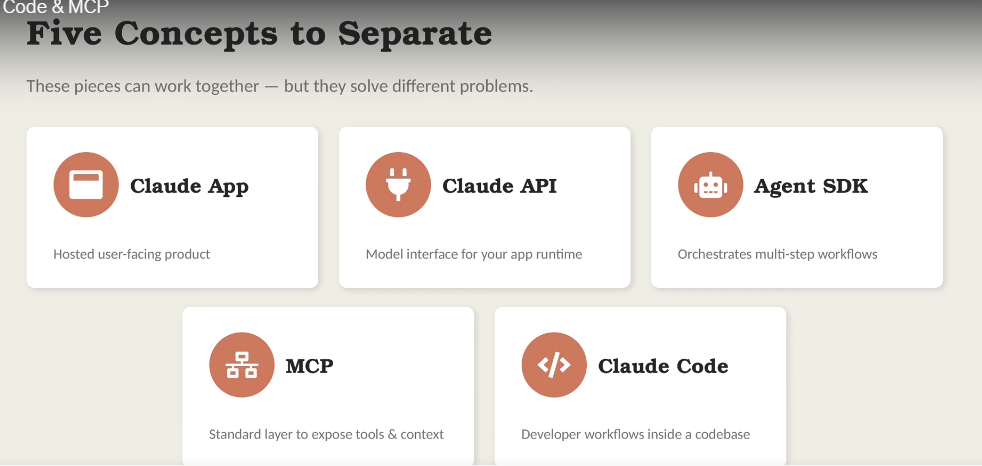
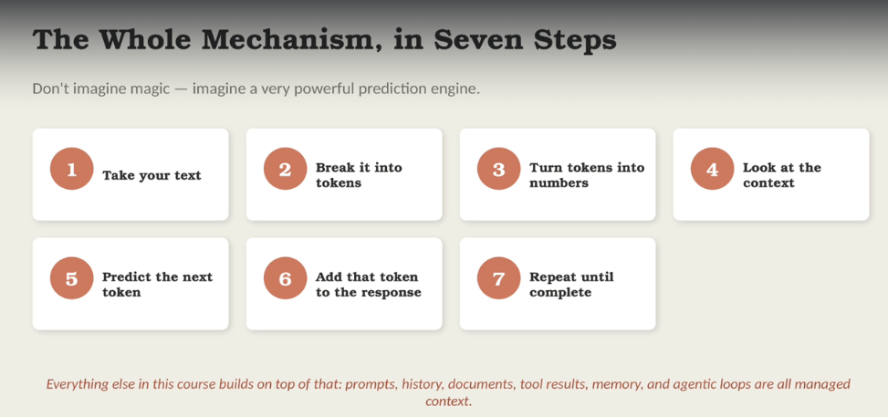

- [Multi-agent-orchestration](https://claudecertificationguide.com/learn/1-agentic-architecture/1-2-orchestration-patterns)
- [UDEMY- Multi-agent-orchestration](https://www.udemy.com/course/cca-f-claude-certified-architect-complete-exam-preparation/learn/lecture/56986917?start=0#overview)

## 5 Concepts

Claude App: The website  of claude is Claude App 
Claude API: The API of claude is Claude API, where you get the key and use SDK to integrate with your application.
Agent SDK: The SDK of claude is Agent SDK, where you can use the SDK to create your own agents and integrate with your application.
MCP: The MCP of claude is Multi-agent orchestration, where you can use the MCP to orchestrate multiple agents and integrate with your application.
Claude Code: Claude Code is an agentic, terminal-based AI coding assistant created by Anthropic that reads codebases, edits files directly, and runs shell and Git commands from natural language prompts, the thing claude extension in VS Code.

- Github of Shopify AI: https://github.com/termidy/CCAR-F 

- 

- `System Prompt`: 
System Prompt gives set of instructions like tone, role and behaviour
The behaviour is guided based on the rules enforced in the backend 

     " You could add one more sentence to separate the two ideas: the system prompt guides how the assistant talks and behaves, but product rules in the backend are what actually enforce actions or restrictions."
