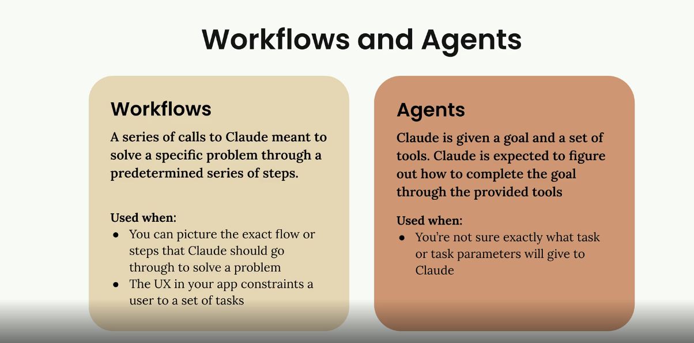
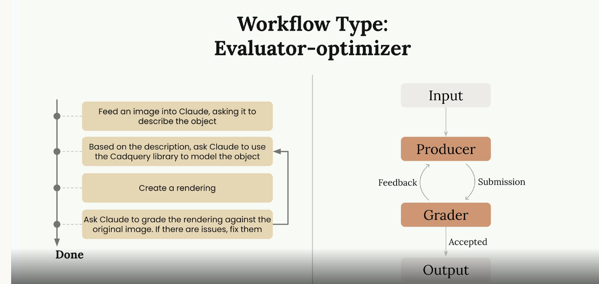
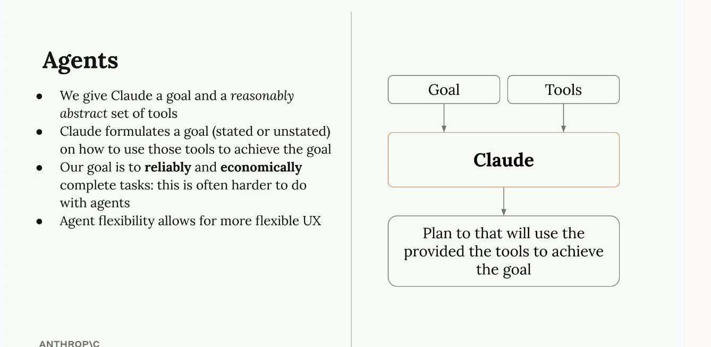
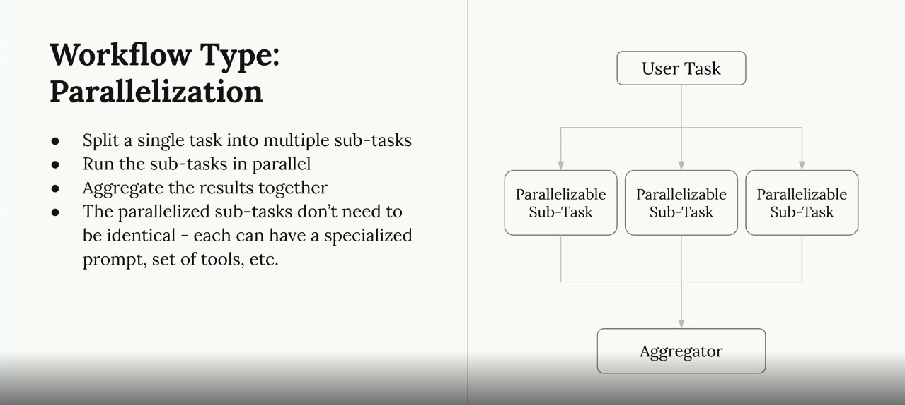
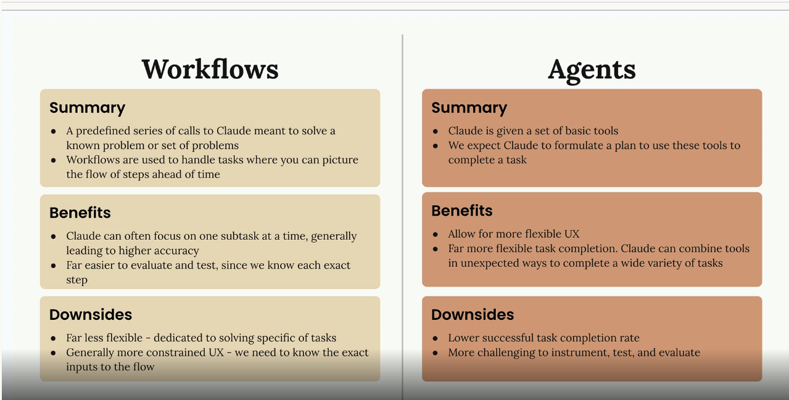
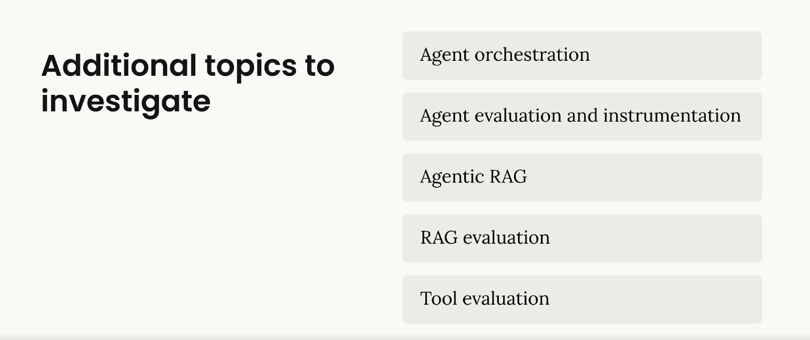

## Agents and Workflows

- `Workflows` : A series of steps that can be sent to Claude to solve, in a specific order to achieve a particular goal. Workflows are typically designed to automate processes and can involve multiple tasks, decision points, and integrations with other systems.
  - This can be used when you can picture the exact flow or steps that are needed to solve a problem
    

- `Agents` : Claude is given a set of tools to complete a task/goal, Claude makes use of these tools and makes decision that solve the given task/goal.
- Agents are exactly used when we don't know what steps are required
  - 

### Parallelization of Workflows

- 
- split a complex task into multiple smaller tasks,
- feed all of them to Claude such that they run in parallel
- Get the Analysis for each step separately
- Feed all the analysis back to Claude to get the final result, Aggregator step.

### Chaining Workflows

### Routing Workflows

Routing workflows solve a common problem in AI applications: different types of user requests need different handling approaches. Instead of using a one-size-fits-all prompt, you can categorize incoming requests and route them to specialized processing pipelines.

### Agent Vs Workflow

## Topics to Learn

