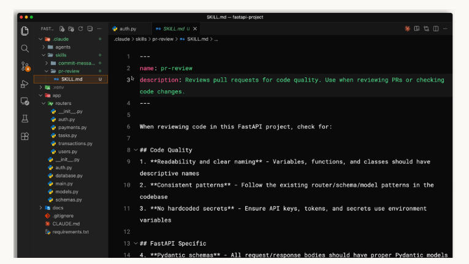

## Claude Agentic Skills

- https://anthropic.skilljar.com/introduction-to-agent-skills

## SKILLS

- Instead of repeating instructions every time you ask Claude to review a PR or write a commit message, you write a skill once and Claude applies it whenever the task comes up
- 
- `Personal skills` go in `~/.claude/skills (your home directory)`. These follow you across all your projects — your commit message style, your documentation format, how you like code explained.
- `Project skills` go in `.claude/skills` inside the root directory of your repository. Anyone who clones the repo gets these skills automatically. This is where team standards live, like your company's brand guidelines, preferred fonts, and colors for web design.

On Windows, personal skills live in `C:/Users/<your-user>/.claude/skills`.

- Skills work best for specialized knowledge that applies to specific tasks:
  - Code review standards your team follows
  - Commit message formats you prefer
  - Brand guidelines for your organization
  - Documentation templates for specific types of docs
  - Debugging checklists for particular frameworks

- Priority of skills:
  - Enterprise --> ie in managed-settings.json
  - Personal --> ie in ~/.claude/skills
  - Project --> ie in .claude/skills inside the repo
  - Plugins --> ie in .claude/skills/plugins

When there is a namimg conflict, the order of priority is: 1st one among the list wins
Lets say you have a skill named `pr-review` in both your personal and project skills. When you ask Claude to review a PR, it will use the `pr-review` skill from your personal skills, since personal skills take precedence over project skills.

1. Enterprise skills (managed by your organization)
2. Personal skills (in your home directory)
3. Project skills (in the repository)
4. Plugin skills (specific to plugins you use)

Best Practices for Skills:
`name` and `description` are required — `allowed-tools` and `model` are optional but powerful additions
A good description answers two questions: What does the skill do? When should Claude use it?
allowed-tools restricts which tools Claude can use when the skill is active — useful for read-only or security-sensitive workflows
Progressive disclosure: keep SKILL.md under 500 lines and link to supporting files (references, scripts, assets) that Claude reads only when needed, we can build a folder structure around skill.md by giving references from script/references/assets folder
Scripts execute without loading their contents into context — only the output consumes tokens, keeping context efficient

`scripts/` — Executable code
`references/` — Additional documentation
`assets/` — Images, templates, or other data files

The agent skills open standard supports several fields in the SKILL.md frontmatter. Two are required, and the rest are optional:

name (required) — Identifies your skill. Use lowercase letters, numbers, and hyphens only. Maximum 64 characters. Should match your directory name.
description (required) — Tells Claude when to use the skill. Maximum 1,024 characters. This is the most important field because Claude uses it for matching.
allowed-tools (optional) — Restricts which tools Claude can use when the skill is active.
model (optional) — Specifies which Claude model to use for the skill.
