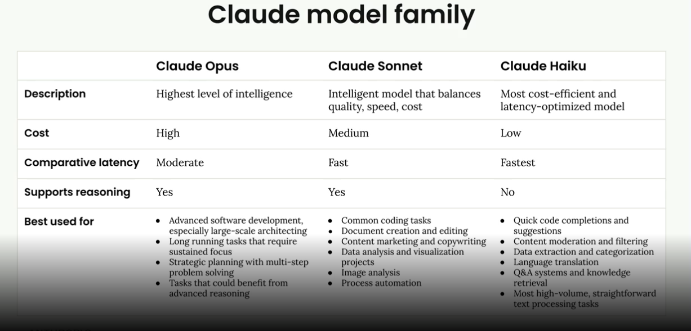
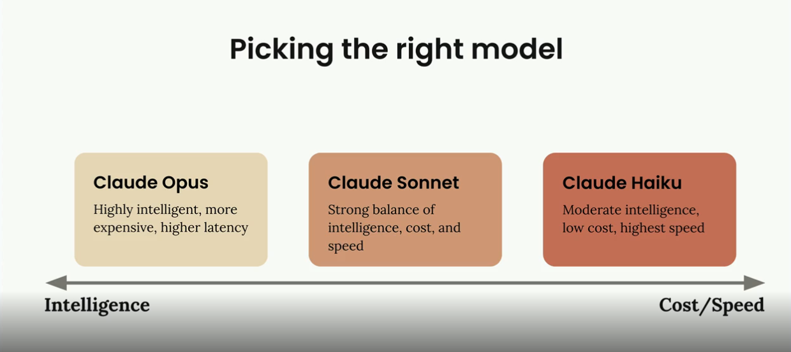
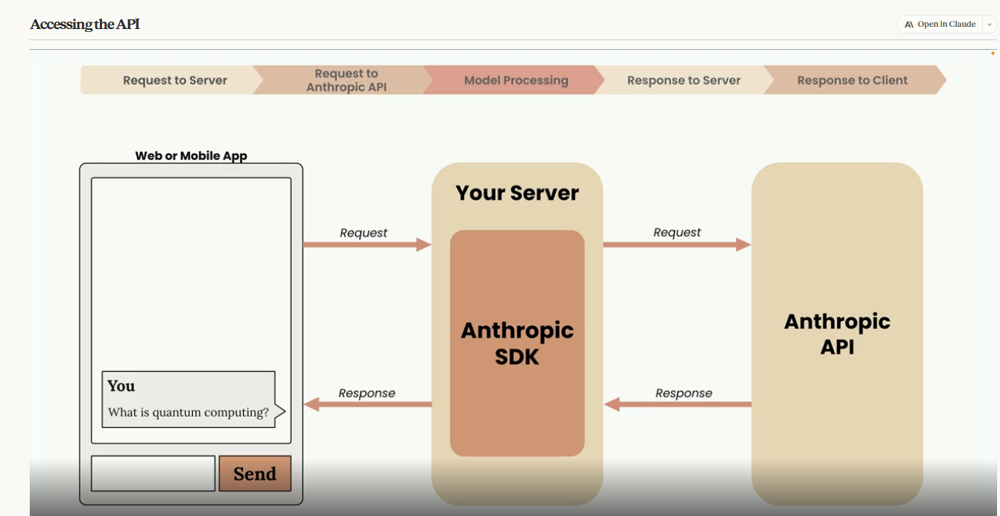
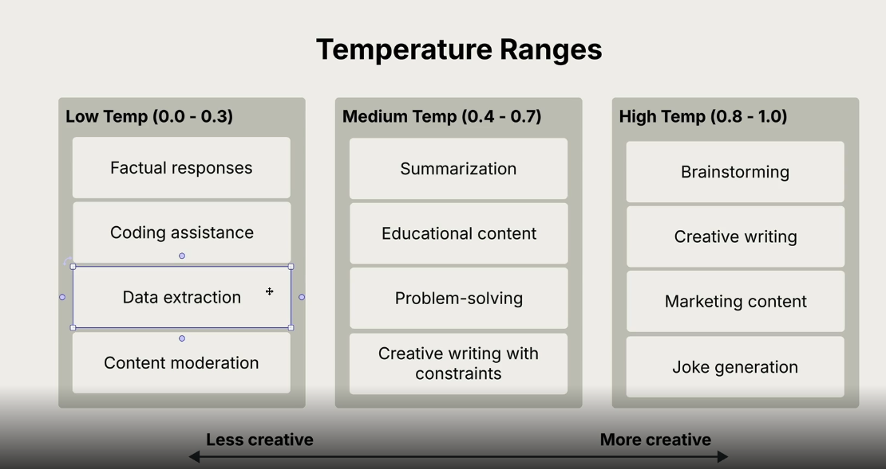
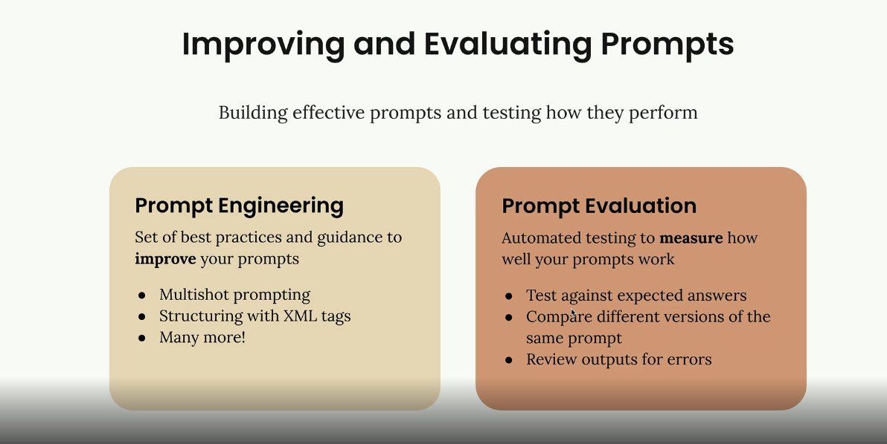
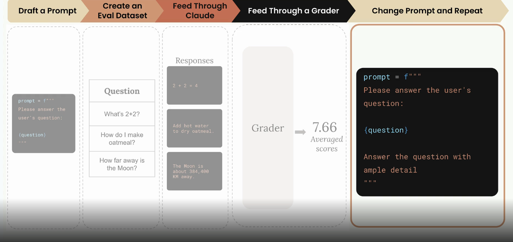
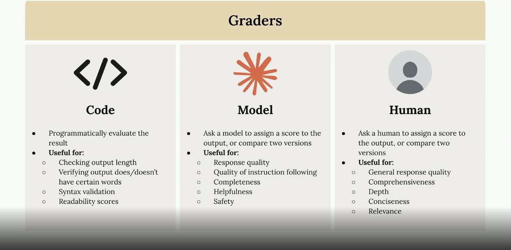
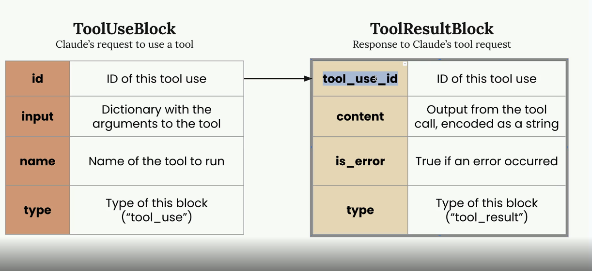
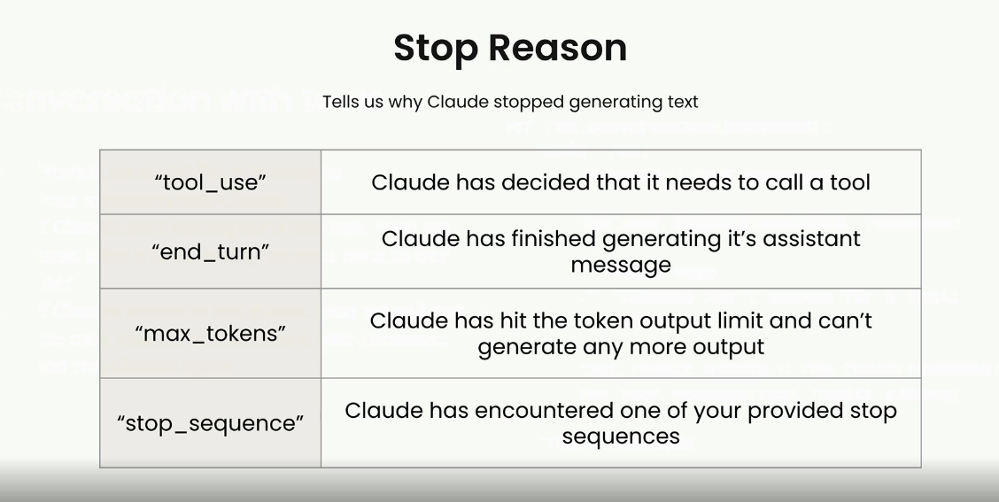
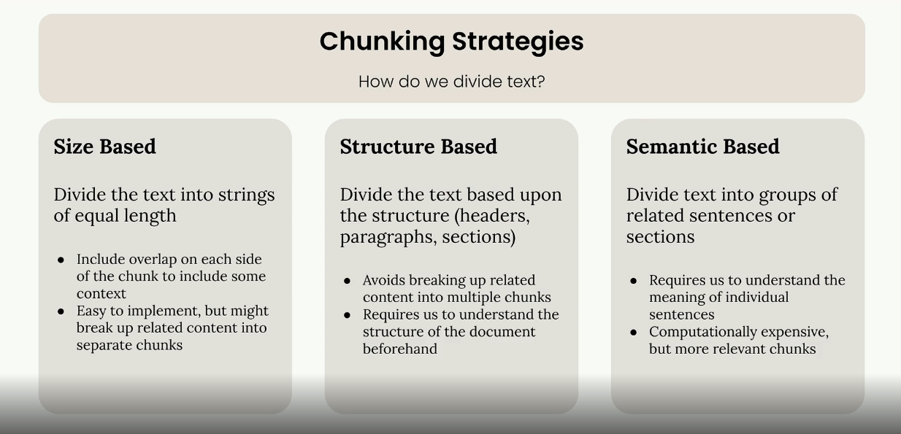

[claude-api](https://anthropic.skilljar.com/claude-with-the-anthropic-api)

## Claude with API

`Claude Model Family`

- 

`Right Model Choice`

- 

`Accessing API`

- When user gives a prompt , the response is generated by Claude model. What happens behind the scenes
- 
- Go through this [Accessing API](https://anthropic.skilljar.com/claude-with-the-anthropic-api/287726)
- To summarize ,
  - User sends a prompt using your web-ui
  - The prompt is sent to the server implemented by you. The server contains Anthropic SDK , or you can also use the HTTP Anthropic API directly. The server sends the prompt to the Anthropic API, along with fields like `api-key`,`message(user-prompt)`, `model`, `max-tokens`,
  - Inside the Anthropic API, The model processing happens , where the prompt undergoes 4 steps
    - Tokenisation: The prompt is converted into tokens broken into subwords.
    - Embedding: The tokens are transformed into dense vectors that capture semantic meaning. .e numerical numbers are given to each token based on its meaning and context.
    - Contextualization: a single word can have multiple meanings based on the context. The model uses the surrounding words to determine the correct meaning of each token and proper weigth is given to each token based on its importance in the context.
    - Generation: The model produces the final output based on the contextualized information. along with EOS(end of sequence) token, which indicates the end of the response.its a reserved word.
  - The response is sent back to the server , that contains feilds like `message(response)`, `usage(i/p +o/p tokens)`, `stop-reason` and the server sends the response back to the user.

- Making a request

```
import Anthropic from 'anthropic'

const client = Anthropic()

const message =client.messages.create({
  model: 'claude-sonnet-4-0',
  max_tokens: 1024,
  message: [
    {
      role: 'user',
      content: 'Write a poem about the beauty of nature.'
    }
  ]
  })
  console.log(message)
```

- Multiple conversations messages, `Anthropic Claude API doesn't store any messages`, as part of the client-server implementation its our job to maintain these messages and send them to the API for each request. The API doesn't have any memory of previous messages, so we need to include the entire conversation history in each request to maintain context.

```
const add_user_message = (messages, text) => {
  messages.push({
    role: 'user',
    content: text
  })
}

const add_assistant_message = (messages, text) => {
  messages.push({
    role: 'assistant',
    content: text
  })
}

const chat = (messages) => {
const message =client.messages.create({
  model: 'claude-sonnet-4-0',
  max_tokens: 1024,
  message: messages
  })
  return message.content[0].text
}

//Execution of multiple conversations
const messages = []
add_user_message(messages, 'Write a poem about the beauty of nature.')
const response1 = chat(messages)
add_assistant_message(messages, response1)

add_user_message(messages, 'Add another paragraph to the poem about the changing seasons.')
const response2 = chat(messages)
console.log(response2)
```

`Temperature`

- Consider example "What do you think" , now the model will draw probabilites for next word , i.e there is high probability for next word to be "about" and low probability for next word to be "banana".

We can control this probability distribution using `temperature` parameter.

Higher temperature values (e.g., 0.8) make the model more creative and diverse in its responses, while lower values (e.g., 0.2) make it more focused and deterministic.



`Streaming Responses`

- The API supports streaming responses, which allows you to receive partial results as they are generated by the model. This can be useful for applications that require real-time feedback or want to display the response as it is being generated. To enable streaming, you can use the `stream` parameter in your request. When set to `true`, the API will send back chunks of the response as they are generated, allowing you to process and display them immediately. This can improve the user experience by providing faster feedback and reducing perceived latency. You can also implement a callback function to handle the streamed data and update your application accordingly.

Each chunk in the stream is an event that contains a portion of the generated text. You can process these chunks as they arrive, allowing you to display the response in real-time or perform other actions based on the streamed data.

You can also access the events in the stream to get information about the progress of the response generation, such as the number of tokens generated so far or any errors that may have occurred. This can help you monitor the performance of the model and handle any issues that arise during the streaming process.

Example of streaming response:

```
import Anthropic from 'anthropic'

const client = Anthropic()
const streamResponse = async (messages) => {
  const stream = client.messages.stream({
    model: 'claude-sonnet-4-5',
    max_tokens: 1024,
    message: messages,
    stream: true
  })

  for await (const chunk of stream) {
    // Process each chunk of the response as it arrives
    console.log(chunk)
  }
}
```

`Structured Responses`

- The API allows you to request structured responses from the model, which can be useful for applications that require specific formats or data structures. You can specify the desired structure in your prompt or use the `response_format` parameter to indicate the expected format of the response. This can help ensure that the model's output is consistent and easier to parse for your application.
  For example, you can request the model to return a JSON object with specific fields, or you can ask for a list of items in a particular format. By providing clear instructions and examples in your prompt, you can guide the model to generate responses that meet your requirements.
  example of structured response:

Not just that , but you can also pass instructions to Claude to generate structured responses in a specific format.

//This way Claude would assume that the `json should not be outputted as part of response
add_assistant_message(message, '`json')

//This way claude will not output anything after the stop sequence, including the stop_sequence itself
chat(message , stop_sequence = '```')

```
import Anthropic from 'anthropic'

const client = Anthropic()
const structuredResponse = async (messages) => {
  const response = await client.messages.create({
    model: 'claude-sonnet-4-5',
    max_tokens: 1024,
    message: messages,
    response_format: 'json'
  })

  console.log(response)
}
```

## Prompt Evaluation

### Prompt Engineering Vs Prompt Evaluation

- 

### Prompt Evaluation Workflow

- 

After grading , you will repeat the steps by changing the prompt, now you will compare grading of prompt_1 and prompt_2 and see which prompt is better. You can also use the grading to improve your prompt and make it more effective. This process of iterating and improving prompts based on evaluation results is a key aspect of prompt engineering.

### Prompt Graders

- 

## Prompt Engineering

- See the videos

## Tools use with Claude

- Claude LLM models have data information that its trained on, LLM models will not have current information, so we need to use `tools` to get current information. Lets say `What is weather in Hyderabad Today`, in such cases we make use of tools .
- Claude can use tools to get current information and perform actions on behalf of the user. The tools can be anything from a `search engine`, a `database`, or an `API` that provides specific functionality.
- By integrating these tools with Claude, we can enhance its capabilities and provide more accurate and up-to-date responses to user queries.

Three tools as part of project

- Get current date time tool
- Additions on top of current date time
- set reminders tool

- 

### Stop reasons

- 

- fine_grain_tool calling will disable json validation at claude level, but response stream will give the output in authentic way without much delay, in this case the json validation is responsibility of the developer, so we need to validate the json response at our end. This is useful when we want to get the response in real time without much delay, but we need to make sure that the response is valid json and we can parse it correctly.

- claude also have ,
- Text edit tools cabability, you need to make specific settings write a schema
- web search tools cpability, you need to make specific settings write a schema

## RAG(Retrieval Augumented Generation) Search

- RAG is all about creating chunks of the input information(can be documents, text, pdfs, etc) and storing them in a vector database. When user gives a prompt, the prompt is converted into vector and then we search for the most relevant chunks from the vector database and then we pass these chunks to the model along with the prompt to generate the response. This way we can provide more accurate and relevant responses to user queries.

- The complexity of RAG lies in the chunking and retrieval process.
- How do we chunk the input information?
  - Size based,
  - structure based
  - semantic based
    

- `Text Embeddings` are used to convert text into vector representation. The embeddings capture the semantic meaning of the text, allowing us to compare and retrieve relevant chunks based on their similarity to the user's prompt. We can use pre-trained embedding models or train our own embeddings based on our specific use case.
- Claude doesn't have any inbuilt vector database, Claude uses Vovyage API for text embeddings, so we need to use external vector databases like `Pinecone`, `Weaviate`, `Milvus`, `Qdrant`, etc.

- vector db `cosine similarity`, `cosine distance`
- Semantic Search + Lexical Search(classic text search) = RAG Search,
- Lexical Search BM25- Best match 25 its an algorithm for classic text search

## Extended Thinking

- The evaluation steps, the reasoning that Claude takes to respond is called as `Extended Thinking`. The model can be prompted to think step by step and provide reasoning for its responses. This can help improve the quality and accuracy of the generated output, especially for complex queries that require multi-step reasoning or problem-solving.
- From code perspective we can use this by supplying params to chat() function.
  - thinking = true,
  - thinking_budget=1024 //minimum is 1024
  - max_tokens=2048 //maximum tokens should always be greater than thinking_budget

  ```
  if(thinking){
    params['thinking'] = {
      type: 'enabled',
      budget_tokens: thinking_budget
    }
  }
  ```

  - The claude returns `ThinkingBlocks` in the response, which contains the reasoning steps taken by the model to generate the final output. This can be useful for debugging and understanding how the model arrived at its response.
  - The ThinkingBlocks are not supposed to be edited or changed by user this is to be used only Claude and should be sent to claude

- `Redacted_thinking` : for generating responses based on the complex prompt given some `magic_string`, that would need to be encrypted , in that case claude returns `RedactedThinkingBlocks`.

## Image/PDF/Citations support

- Claude also provides Image/PDF/Citations support, which allows the model to generate responses that include images, PDFs, or citations. This can be useful for applications that require visual or reference-based information in addition to text-based responses. You can specify the desired format in your prompt or use the appropriate parameters to indicate the expected output type. (Refer Videos)

## Prompt Caching

- Claude caches your prompt and responses for 1hr only, within 1hr if you ask for the same query response Claude will return the cached response, after 1hr the cache is cleared and Claude will generate a new response for the same query.
- TextBlockWithBreakpoint, claude caches all the content till the breakpoint , including the message of the `TextBlockWithBreakpoint`. The messages after that block will not be cached
- We can add cache to tools, schema, system-prompts also 
```
cache_control: {type: "ephemeral"}
```
- all the cached breakpoints are joined together by claude , so the order of priority in caching is as follows 
  - Tools
  - Schema
  - System-Prompts
  - user messages
  - assistant message

### Code Execution and File API
- In short first we need to upload a file to claude Ahead of time(AOT) ,  which has huge calculation data etc, claude will analyse the file and then use it internal Code Execution tool,
- The Code Execution tool exists inside a docker handle by Claude itself , the response from the docker are fed to Claude, the access to docker is restricted and the docker is not accessible to user, so we need to use the Code Execution tool to run the code inside the docker and get the response from Claude.


