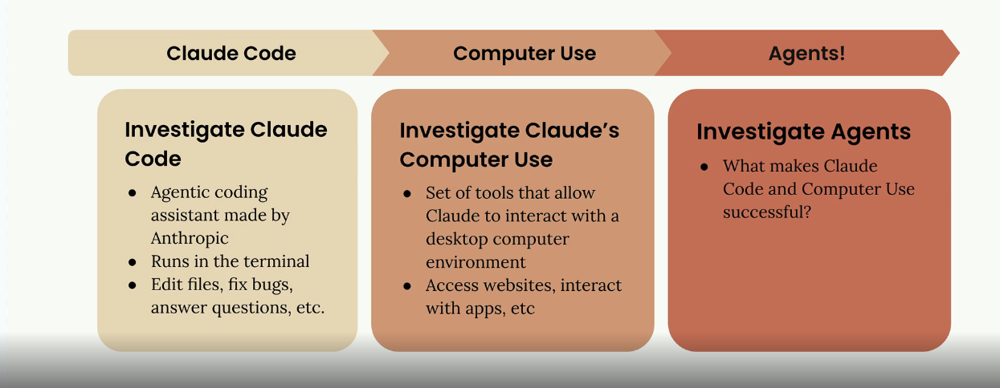
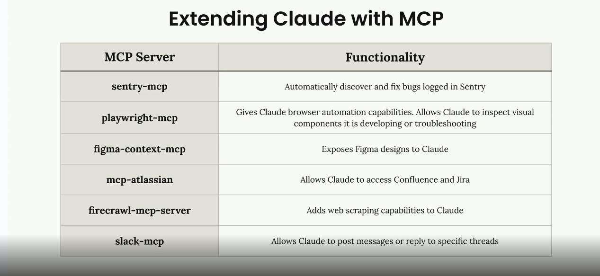

Claude apps:

- 
- there are two different apps that claude provides for the users to use.
  - Claude Code: Agentic coding, runs in terminal, edit files fixes bugs etc
  - Computer Use: tools that allow you to interact with desktop computer environment, Access websiites, interact with apps etc
  - using clade code cli, we can also add mcp servers and start using them, because claude code cli has an in build mcp client that can communicate with mcp servers.
  - With above fact that mcp servers can be added, we can use the Claude Code Cli for following usecases:
    
