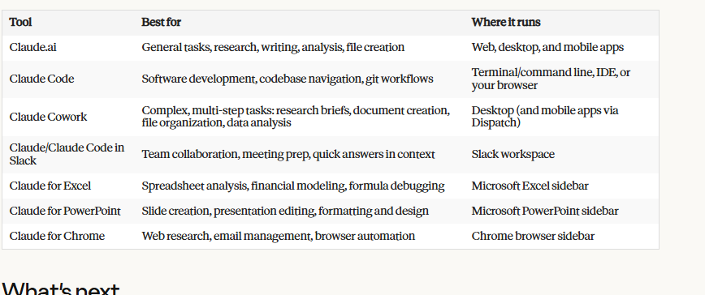
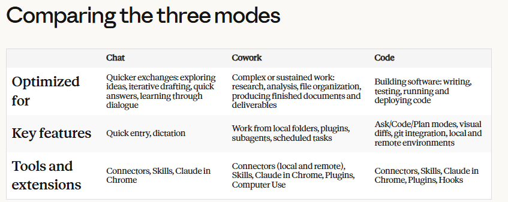
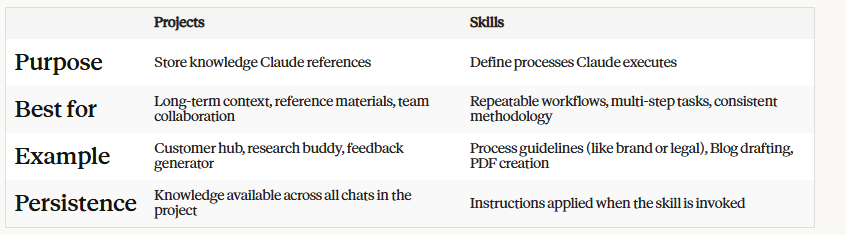
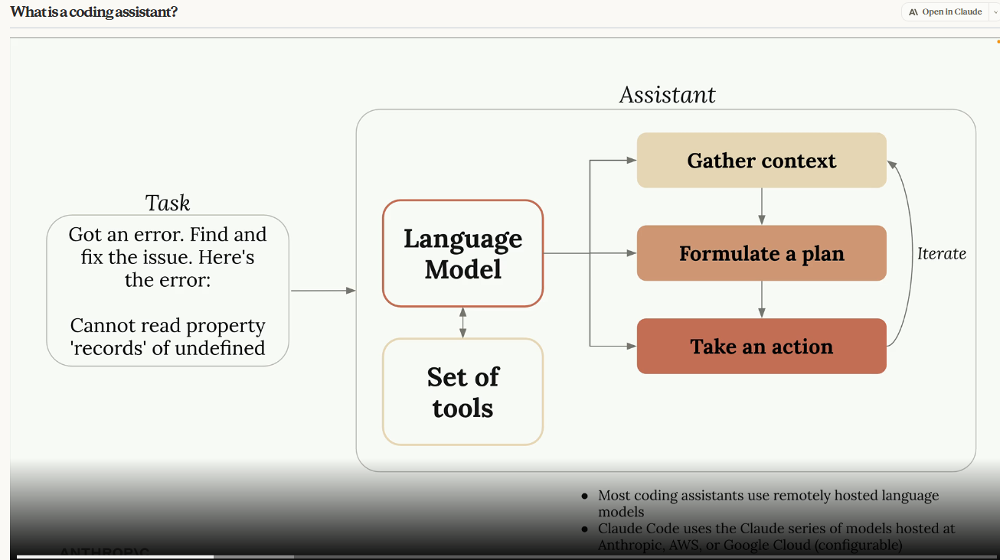
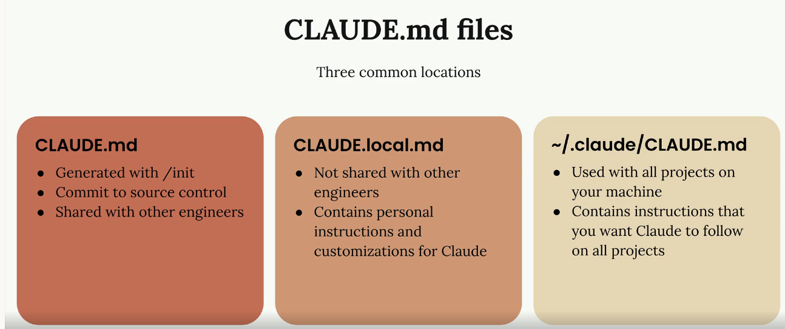
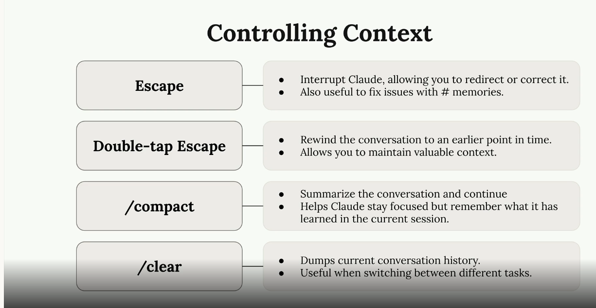

AI Fluency: https://www.youtube.com/watch?v=JpGtOfSgR-c

- This course focuses on `human-AI collaboration`, not just understanding AI as a technology.
- AI Fluency means engaging with AI systems `effectively, efficiently, ethically, and safely`.
- The AI Fluency Framework centers on the `"4D" competencies of Delegation, Description, Discernment[mental ability to grasp, comprehend, or judge things clearly] and Diligence.`
- The goal is to develop lasting skills that remain relevant as AI technology evolves.
- Effective AI collaboration requires both practical skills and a fundamental shift in how we think about working with AI.

There are three primary ways we engage with AI:
Automation: AI executes specific tasks based on your instructions
Augmentation: You and AI collaborate as creative thinking and task execution partners
Agency: You guide AI to work independently on your behalf, shaping its knowledge and behavior rather than specific actions

"4Ds": Delegation, Description, Discernment, and Diligence.

Delegation: Thoughtfully deciding what work to do with AI vs. doing yourself
Description: Communicating clearly with AI systems
Discernment: Evaluating AI outputs and behavior with a critical eye
Diligence: Ensuring you interact with AI responsibly

- Claude Can be used as
  - claude.ai: A web-based interface for interacting with Claude, suitable for general use and experimentation. desktop, mobile
  - claide.code: A code-based interface for integrating Claude into applications and workflows, ideal for developers and technical users. API access, SDKs, CLI tools
  - claude and slack: Integration of Claude into Slack for seamless collaboration and communication within teams. Slack integration, chat-based interactions, workflow automation
  - claude for excel: A specialized version of Claude designed to work with Microsoft Excel, enabling users to leverage AI capabilities directly within their spreadsheets. Excel integration, data analysis, formula generation, automation of tasks

  

### Claude Modes



### Project Workspaces

- When your project knowledge approaches the context window limit, Claude seamlessly enables RAG mode. Instead of loading all project content into memory at once, Claude intelligently searches and retrieves only the most relevant information needed to answer your questions. This expands your project's capacity by up to 10x while maintaining response quality.

### Artifacts

Claude generated HTML/PDF/Reports etc etc are all saved as artifacts in the project workspace. These artifacts open up in the split window(similar like browser preview) to see the results. You can easily access, share, and manage these outputs within the workspace, ensuring that all your project-related materials are organized and readily available for collaboration and reference.

### Skills

Skills are folders of instructions, scripts, and resources that Claude loads dynamically to improve performance on specialized tasks. Think of them as expertise packages—they teach Claude how to complete specific tasks in a repeatable way.
Here's how to enable Skills:

- Navigate to Settings > Capabilities
- Ensure that Code execution and file creation is toggled on
- Scroll to the Skills section
- Toggle individual skills on or off as needed

### Projects Vs Skills



### What are Connectors in Claude?

Connectors are pre-built integrations that allow Claude to access and interact with external data sources and tools. They enable you to connect Claude to platforms like Google Drive, Notion, Slack, and more, allowing it to retrieve information, perform actions, and enhance its capabilities by leveraging data from these sources. Connectors expand the range of tasks Claude can assist with by providing seamless access to relevant information and functionalities from various applications.
Desktop Connectors and Web Connectors are two types of connectors available in Claude, each designed for different environments and use cases:

- Desktop Connectors: These connectors are designed to integrate with applications and tools on your local desktop environment. They allow Claude to access files, applications, and data stored on your computer. Examples include connectors for file management systems, local databases, or desktop productivity tools.
- The Model Context Protocol (MCP) powers connectors. Think of MCP like USB-C for AI—a universal standard that allows Claude to connect to many different applications through a single, consistent interface. This open standard means developers can build connectors for any tool, and those connectors work seamlessly with Claude.
- Web Connectors: These connectors are designed to integrate with web-based applications and services. They enable Claude to interact with online platforms, retrieve information from the web, and perform actions on web-based.

### Researching with Claude

Research is an advanced feature that transforms Claude from a conversational assistant into a systematic investigator. When you enable Research, Claude doesn't just answer your question—it explores it from multiple angles, synthesizing information from across the web and your connected integrations.

- Research transforms how Claude finds and analyzes information.
- Research delivers comprehensive answers in minutes. Most reports complete in 5 to 15 minutes, though more complex investigations may take up to 45 minutes—work that would typically require hours of manual research.
- Extended thinking is automatically enabled with Research
- Citations make verification easy. Research delivers thorough answers complete with easy-to-check citations,

How Research works
When you enable Research, you're activating an agentic, multi-step process that goes far beyond a simple web search. Claude autonomously decides what to search next based on what it has already found, pursuing leads and filling gaps without you needing to direct each step.

Step 1: Claude plans its approach. When Research is enabled, extended thinking automatically activates. This lets Claude break down your request, identify what information it needs, and plan how to investigate different angles of your question.
Step 2: Claude conducts multiple searches. Rather than running a single search, Claude conducts many searches that build on each other. It determines what to investigate next based on what it finds, pursuing promising leads and filling in gaps.
Step 3: Claude synthesizes findings. After gathering information from multiple sources—including the web and any connected integrations like Gmail, Google Calendar, or Google Drive—Claude compiles everything into a comprehensive, well-organized report.
Step 4: Claude provides citations. Every claim in Research reports links back to its source, making it easy to verify information and dig deeper when needed.

Since Research can take 5 to 45 minutes depending on complexity, investing time in crafting your prompt pays off. Here are some strategies:

Be specific about your goals. Instead of "Tell me about the EV market," try "Analyze the electric vehicle battery market—identify key players, technology trends, and supply chain challenges that might affect investment decisions."
Specify the sections or structure you want. Claude will organize its findings around the structure you provide. For example: "Compare venue options for a team offsite including: location and accessibility, meeting space and amenities, catering options, and pricing considerations."
Include relevant constraints. Budget ranges, timelines, geographic requirements, and other parameters help Claude focus its research on relevant options.
Ask Claude to help refine your prompt. If you're not sure how to frame your research question, you can even ask Claude to help you write a better Research prompt before enabling the feature.

## Claude Code

Coding Assistant behind the scenes


- LLM model only understands text and respond in text, it cannot create files, run code, or access the internet. To enable these capabilities, we have a `coding assistant` that acts as an intermediary between the LLM and the external environment. The `coding assistant` receives instructions from the `LLM`, executes code, creates files, and retrieves information from the internet as needed to fulfill the user's request.
- The `coding assistant` is designed to be secure and efficient, ensuring that it only executes code that is necessary for the task at hand and that it does so in a controlled environment to prevent any potential security risks. By using the `coding assistant`, Claude can perform a wide range of tasks that go beyond simple text generation, making it a powerful tool for developers and non-developers alike.
- The LLM Models like Opus, Sonet, Haiku also have understanding on tools to complete their majority of tasks. Not all LLMS understand the tools with finesse, but the ones that do can leverage them to perform complex tasks that would be difficult or impossible for a human to do alone. By using tools, these LLMs can access external data, perform calculations, generate files, and interact with other software, greatly expanding their capabilities and usefulness in a wide range of applications.

### How Tool Use Works

When you send a request to a coding assistant, it automatically adds instructions to your message that teach the language model how to request actions. For example, it might add text like: "If you want to read a file, respond with 'ReadFile: name of file'"

Here's the complete flow:

- You ask: "What code is written in the main.go file?"
- The coding assistant adds tool instructions to your request
- The language model responds: "ReadFile: main.go"
- The coding assistant reads the actual file and sends its contents back to the model
- The language model provides a final answer based on the file contents

This system allows language models to effectively "read files," "write code," and "run commands" even though they're really just generating carefully formatted text responses.

### Install Claude Code

Install Claude Code

`From Command Prompt:`

- `MacOS, Linux, WSL`: curl -fsSL https://claude.ai/install.sh | bash
- `Windows PowerShell`: irm https://claude.ai/install.ps1 | iex
- `Windows Command Prompt (cmd.exe)`: curl -fsSL https://claude.ai/install.cmd -o install.cmd && - install.cmd && del install.cmd
- `MacOS (Homebrew)`: brew install --cask claude-code

- For claude to understand your project in cmd

```
<project_path > claude
<project_path > /init

--> This will generate claude.md file in the project directory which will be used by claude to understand the project and its files. You can also add any specific instructions or information about the project in this file to help claude better understand it.
```

If you want `personal Instructions` we can create claude.local.md file in the project directory and add any specific instructions or information about the project in this file to help claude better understand it. This file will be used by claude to understand the project and its files. You can also add any specific instructions or information about the project in this file to help claude better understand it.

~/.claude/claude.md is the global claude file, if you want all the projects to follow some instructions we can place here



- #: used to address claude.md files inside the cmd
- @: used to reference the file names
- 

Claude Custom Commands:

- `.claude/commands/write_tests.md`: This command provides instructions on how to write tests for a given set of arguments. It outlines testing conventions, test coverage guidelines, and best practices for writing meaningful tests that ensure the quality and reliability of the codebase.

## Hooks

- `PreToolUse` and `PostToolUse` hooks allow you to execute custom logic before and after a tool is used by Claude. This can be useful for tasks like logging, modifying inputs or outputs, or implementing additional functionality around tool usage.
- `PreToolUse` Hook: This hook is triggered before a tool is executed. You can use it to perform actions such as validating inputs, logging the tool usage, or modifying the parameters that will be passed to the tool. For example, you might want to check if the user has the necessary permissions to use a particular tool before allowing it to execute.
- `PostToolUse` Hook: This hook is triggered after a tool has been executed. It allows you to perform actions based on the results of the tool's execution. For instance, you could log the output of the tool, send notifications based on the results, or even trigger additional processes if certain conditions are met.
- You add these hooks inside `.claude/settings.local.json` file in the project directory. Here's an example of how to set up these hooks:

```json
{
  "hooks": {
    "preToolUse": [
      {
        "matcher": "Read | Grep",
        "hook": [
          {
            "type": "",
            "command": "node ./hooks/read_hook.js" // write your custom logic inside read_hook.js file
          }
        ]
      }
    ],
    "postToolUse": [{}]
  }
}
```

- Other tools that are been used inside your project
  https://anthropic.skilljar.com/claude-code-in-action/312427

### Claude Code SDK

- 
